# Deep Learning — theory notes

These notes are for the written paper. Read them in order. Each unit follows the portion list, and each section is written so it can be copied into an answer booklet: definition, figure, equation, example, and a comparison or a limit.

A theory answer has five parts.

1. Say what the method is for.
2. Redraw the figure from that section and label it.
3. Write the equation and say what every symbol means.
4. Give the worked example from class, with the numbers or the sentence.
5. Close with one comparison or one limitation.

The figures are the ones to redraw. The examiner marks the labels.

---

## Portion checklist

| Portion line | Where it is taught below |
|---|---|
| CNN architecture | A1–A4, A6 |
| Pooling | A3 |
| Convolution and its variants | A2 |
| Transfer learning | A7 |
| CNN for object recognition and computer vision | A6 |
| RNN | B1–B3 |
| Bidirectional RNN | B4 |
| Encoder–decoder | B5 |
| Recursive nets | B6 |
| LSTM | B7 |
| Gated RNN (GRU) | B8 |
| Attention | B9 |
| Transformers | B10 |
| RNN for sentiment | B11 |
| BERT for NLP | B12 |
| Attention for speech and for vision | B13 |
| Autoencoders | C1–C3 |
| Deep Boltzmann machine | C5 |
| Deep belief network, its architecture, greedy learning | C4, C5 |
| Speech recognition using a DBN | C6 |
| GAN | C7 |
| Semi-supervised learning | C8 |

---

# Unit A — Convolutional neural networks

## A1. Why a CNN, and the full architecture

A photograph is a grid. A pixel matters because of the pixels next to it. A fully connected net on a $`224 \times 224 \times 3`$ image would give every pixel its own weight into every hidden unit. That is a huge number of parameters, and a cat in the left corner and the same cat in the right corner look like different inputs.

A CNN slides a small filter across the grid and **reuses the same weights at every position**. Two consequences, both from the lecture:

- far fewer parameters than a fully connected net on the same image;
- the same local pattern (an edge, an eye, a wheel) can fire wherever it sits. The net is robust to a small spatial shift.

The stack used for recognition is:

1. **Convolution** — extracts local features. Early layers learn edges and colours. Later layers learn parts and objects.
2. **Activation** (usually ReLU) — without a nonlinearity, stacked layers collapse to one linear map.
3. **Pooling** — shrinks height and width.
4. Repeat convolution and pooling until the maps are small and abstract.
5. **Fully connected layers** — every unit connects to every unit in the next layer, and mixes the maps into a decision.
6. **Softmax** — turns the last scores into class probabilities.
7. **Dropout**, used in training on AlexNet, sits between the last pool and the first fully connected layer so that units cannot co-adapt.

Dropout randomly drops units **during training**, often 20% to 50% of them. At test time every unit is used. It is a regulariser, not a feature extractor.

**Short answer.** A CNN uses shared local filters on a grid, so it has fewer parameters than a fully connected net and can detect a pattern anywhere in the image.

**Long answer.** Draw the pipeline below. Name the job of each block. Say that dropout, on AlexNet, sits between the last pool and the first fully connected layer and is used only while training.

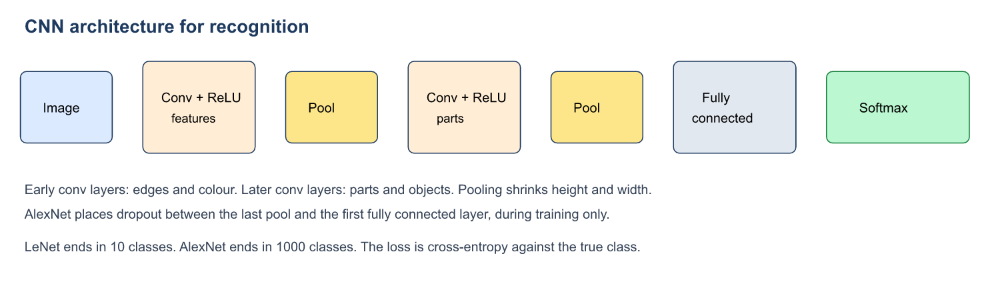

Count the parameters once, so the “fewer weights” claim is not a slogan. A fully connected unit that sees a $`224 \times 224 \times 3`$ image has $`224 \times 224 \times 3 = 150528`$ weights, before the bias. One $`3 \times 3`$ filter on the same three-channel image has $`3 \times 3 \times 3 = 27`$ weights, reused at every position. Sixty-four such filters are still only $`64 \times 27`$ weights in that layer. The saving is the reuse, not a smaller image.

What each stage is allowed to claim in an answer:

- Convolution extracts a local pattern and writes a feature map.
- ReLU, $`\max(0, x)`$, is there because a stack of linear maps is still one linear map.
- Pooling reduces height and width. It does not learn a kernel.
- The fully connected layers mix every feature into every next unit.
- Softmax turns the last scores into a distribution over classes. Training uses cross-entropy.

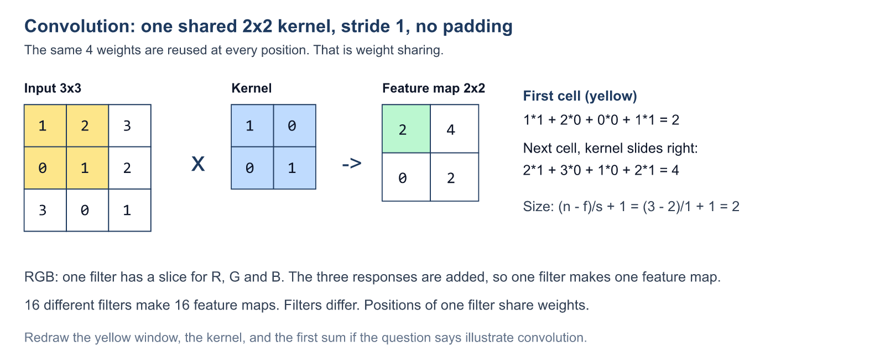

## A2. Convolution, the size formula, and the variants

One filter is a small tensor of weights, often $`3 \times 3`$ or $`5 \times 5`$. Odd size is used so the filter has a **centre pixel**. Place it on the image, multiply element by element, add, write one number, then slide.

**Worked example.** Input


```math
\begin{bmatrix} 1 & 2 & 3 \\ 0 & 1 & 2 \\ 3 & 0 & 1 \end{bmatrix}
\quad
\text{kernel}
\begin{bmatrix} 1 & 0 \\ 0 & 1 \end{bmatrix}
```


Stride 1, no padding. Top-left output $`= 1\cdot 1 + 2\cdot 0 + 0\cdot 0 + 1\cdot 1 = 2`$. The window then slides right: $`2\cdot 1 + 3\cdot 0 + 1\cdot 0 + 2\cdot 1 = 4`$. The feature map is


```math
\begin{bmatrix} 2 & 4 \\ 0 & 2 \end{bmatrix}.
```


The same four weights produced every output. That is weight sharing. A second filter, with different weights, produces a second feature map. Sixteen filters produce sixteen maps.

**Output size.** Image $`n \times n`$, kernel $`f \times f`$, stride $`S`$, padding $`P`$:


```math
\frac{n + 2P - f}{S} + 1.
```


Check it. $`n = 5`$, $`f = 3`$, $`S = 1`$, $`P = 0`$ gives $`(5-3)/1 + 1 = 3`$. That is the $`5 \times 5 \to 3 \times 3`$ map from class. $`n = 32`$, $`f = 5`$, $`S = 1`$, $`P = 0`$ gives 28. With $`P = 2`$, the same layer keeps size 32.

### Variants you must be able to separate

| Variant | What changes | Why it exists |
|---|---|---|
| Stride S > 1 | The filter jumps. The map gets smaller. | Downsampling without a separate pool. |
| Zero padding | A border of zeros. With the right P, height and width stay the same, and border pixels are still filtered. | “Same” convolution. |
| Many channels (RGB) | The filter has one slice per input channel. The slice results are **added**, so one filter still makes **one** feature map. | Colour. |
| 1 x 1 convolution | Looks at a single pixel and mixes the channels. It can change the number of channels. It does not look at neighbours. | Used inside Inception. Local, and cheap depth change. |
| Stack of 3 x 3 (VGG) | Two stride-1 3 x 3 layers see as far as one 5 x 5. | 9+9 = 18 weights instead of 25 per input channel, and two ReLUs instead of one. Three 3 x 3 layers see as far as one 7 x 7. |
| Parallel kernel sizes (Inception) | 1 x 1, 3 x 3 and 5 x 5 run at the **same** level and are concatenated. | Width, not only depth. Small kernels see local structure; large kernels see a wider pattern. |
| Transposed convolution | Learnable upsampling. Used in the decoder of a convolutional autoencoder to grow the map back. | Restores spatial size. It is not the exact mathematical inverse of the encoder’s convolution. |

Weight sharing does not mean every filter in the layer is a copy of the first filter. Filters differ from each other. The positions visited by one filter share that filter’s weights.

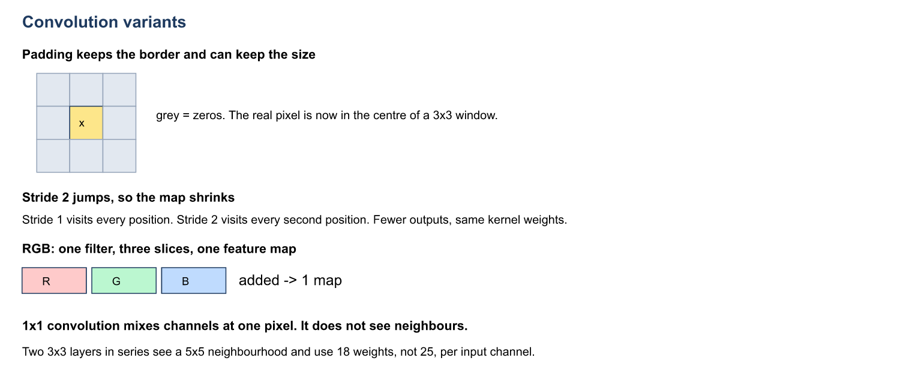

**Padding, written out.** Suppose the image is $`5 \times 5`$ and the kernel is $`3 \times 3`$, stride 1. With $`P = 0`$ the output is $`3 \times 3`$, and the centre of the kernel never sits on a corner pixel. With $`P = 1`$ the formula gives $`(5 + 2 - 3)/1 + 1 = 5`$. The map stays $`5 \times 5`$, and every original pixel is a centre. The added border is zeros in the class example. This is the “same” convolution. “Valid” means $`P = 0`$.

**Stride, written out.** The same $`5 \times 5`$ image and $`3 \times 3`$ kernel with stride 2 and no padding gives $`(5 - 3)/2 + 1 = 2`$. The kernel jumps. The number of learned weights does not change. Only the number of positions changes.

**Several channels.** A colour image is three maps. One filter is three kernels of the same spatial size. At each position the three responses are added, plus a bias, and that sum is one entry of one feature map. If the layer has 64 filters, the output has 64 maps. Do not say “three filters because the image is RGB”.

**$`1 \times 1`$ convolution.** The window is a single pixel, so neighbours are invisible. Across channels it is a small fully connected mix, and it can change the number of channels. Inception uses it as the local branch and also to thin a thick stack of maps before a $`3 \times 3`$ or $`5 \times 5`$ branch, which is why the naive module (large filters on the full depth) is expensive and the version with $`1 \times 1`$ bottlenecks is the one that is trained.

**Transposed convolution.** The decoder of a convolutional autoencoder has to grow a small code back to the image size. A transposed convolution is a learnable upsampling. It is not the exact inverse of the encoder convolution: it does not recover the identical input, it only restores the spatial size so a reconstruction can be compared with $`x`$.

**2 marks.** State the size formula and compute one example.

**10 marks.** Define convolution, compute a $`2 \times 2`$ or $`3 \times 3`$ example, then explain stride, padding, and multi-channel summation. Close with VGG’s $`3 \times 3`$ stack or Inception’s parallel kernels as the “variant” the question is fishing for.

## A3. Pooling

Pooling shrinks the map. It has **no weights**.

From the lecture, the types are max, min, average, and global (including global average).

**Worked max pool.** Window $`2 \times 2`$, stride 2, on


```math
\begin{bmatrix}
1 & 3 & 2 & 0 \\
4 & 2 & 1 & 5 \\
0 & 6 & 3 & 1 \\
2 & 1 & 7 & 4
\end{bmatrix}
\rightarrow
\begin{bmatrix} 4 & 5 \\ 6 & 7 \end{bmatrix}.
```


Average of the same four windows: $`2.5,\ 2,\ 2.25,\ 3.75`$.

If the strong activation only moves inside its window, the max does not change. That is a little translation tolerance. Global average pooling replaces a whole feature map by one number, which cuts the size of the fully connected layers that would otherwise follow.

LeNet uses **average** pooling. AlexNet uses **max** pooling.

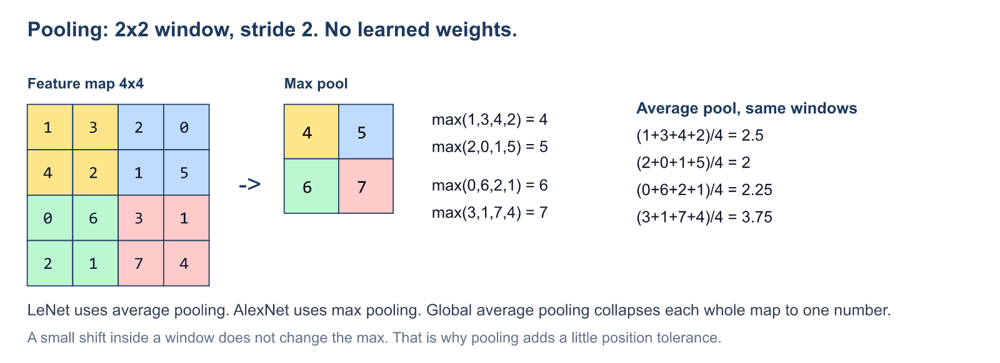

## A4. Local response normalisation and dropout

ReLU is $`\max(0, x)`$. Positive values are not squashed, so in a deep net activations can grow. **Local response normalisation** is a non-trainable competition: a locally strong response suppresses its surroundings. This is lateral inhibition.

- **Inter-channel** LRN competes across nearby feature maps at one pixel.
- **Intra-channel** LRN competes across a spatial neighbourhood of the same map.

The lecture’s hyperparameters are $`(k, \alpha, \beta, n)`$. Do not confuse LRN with batch normalisation. LRN is not trained. Batch normalisation, used in Inception and ResNet, rescales a mini-batch and **is** part of training.

## A5. The named architectures — this comparison is a 10-mark question

Learn this table until you can rewrite it from memory.

| | Input | Parameters | Activation | Pooling | What is special |
|---|---|---|---|---|---|
| **LeNet** | 32 x 32 grayscale digits, 10 classes | ~60,000 | tanh, then softmax | average | The small handwritten-digit CNN. Lecture counts conv+pool as 5 stages and 3 fully connected layers. |
| **AlexNet** | 227 x 227 x 3, 1000 classes | ~60 million | ReLU, then softmax | max | Dropout between last pool and first dense layer. LRN. |
| **ZFNet** | AlexNet-style | — | — | — | Same idea as AlexNet, hyperparameters adjusted. |
| **VGG** | 224 x 224 x 3 | ~138 million | ReLU | max (5 pools) | 13 convolutions of 3 x 3, 3 fully connected layers. VGG-19 is one version. Large kernels are replaced by stacks of small ones. |
| **Inception (GoogLeNet)** | ImageNet-scale | much lighter than VGG | ReLU | inside the module | Several filter sizes **in parallel** at one level. Batch norm. RMSprop. |
| **ResNet** | ImageNet-scale | ~11 million in the lecture’s figure | ReLU | yes | Skip connections, because a plain very deep net gets worse (vanishing gradient). Batch norm. |

**Why ResNet works.** A plain stack has to learn the whole mapping $`H(x)`$. A residual block learns $`F(x) = H(x) - x`$, and the output is


```math
y = F(x) + x.
```


If the best mapping is “do nothing”, $`F`$ can be near zero, which is easier than forcing many nonlinear layers to copy $`x`$. The addition is also a path for the gradient that does not pass through every weight. The LSTM section uses the same idea through time. Say that sentence in both answers.

- **Identity** shortcut: $`x`$ is added as it is, because the shapes already match.
- **Projection** shortcut: channels or spatial size changed, so a $`1 \times 1`$ convolution maps $`x`$ to the right shape before the addition.

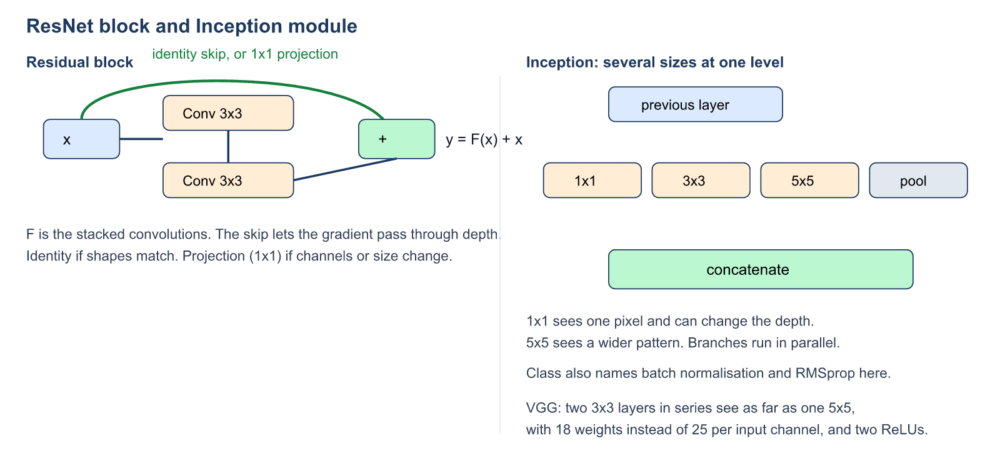

Write the comparison as sentences, not as a hope that the booklet has a ruled table. One paragraph each is enough if the numbers are right.

**LeNet.** Handwritten digits. Input $`32 \times 32`$ grayscale, 10 classes, about 60,000 parameters. Hidden activations are tanh. The last layer is softmax. Pooling is average. The lecture counts a convolution-plus-pool stage as one layer and describes five such stages plus three fully connected layers. This is the small network. Do not give it ReLU, max pooling, or 60 million weights.

**AlexNet.** ImageNet. Input $`227 \times 227 \times 3`$, 1000 classes, about 60 million parameters. Hidden activations are ReLU, because tanh saturates and slows training, and the last layer is softmax. Pooling is max. Dropout sits between the last pool and the first fully connected layer. Local response normalisation is present because ReLU, $`\max(0, x)`$, does not bound large positive values: a strong response suppresses its neighbours. That suppression is not trained. Inter-channel normalisation competes across nearby feature maps at one pixel. Intra-channel normalisation competes across a spatial patch of one map.

**ZFNet.** The lecture treats it as AlexNet with the hyperparameters adjusted: smaller filters and a gentler first stride, so more of the image survives the first layer. It is not a residual network.

**VGG.** Input $`224 \times 224 \times 3`$, about 138 million parameters, 13 convolutions, 5 max-pools, 3 fully connected layers. Every convolution the lecture cares about is $`3 \times 3`$. Two of them, stride 1, see as far as one $`5 \times 5`$: the second layer’s centre looks at a $`3 \times 3`$ that itself summarises a $`3 \times 3`$, which reaches two pixels further on every side. Weights per input channel per output channel: $`9 + 9 = 18`$ against $`25`$, and there are two ReLUs instead of one. Three $`3 \times 3`$ layers match one $`7 \times 7`$. VGG-19 is one of the versions. The parameter count is large because the fully connected tail and the number of channels are large. The saving is relative to using the big kernels, not relative to AlexNet.

**Inception (GoogLeNet).** A layer is made wider instead of only deeper. At one level, $`1 \times 1`$, $`3 \times 3`$, $`5 \times 5`$, and a pooling branch run in parallel and are concatenated. The small kernel sees a local pattern. The large kernel sees a wider pattern. The lecture also names batch normalisation and the RMSprop optimiser for this network. The naive module applies the large kernels to the full incoming depth and is costly. A $`1 \times 1`$ convolution in front of the $`3 \times 3`$ and the $`5 \times 5`$ reduces that depth first.

**ResNet.** A plain stack gets worse as it gets deeper, including on the training set, because the gradient vanishes on the way down. A block learns the residual $`F(x)`$ and outputs $`y = F(x) + x`$. If the useful mapping is the identity, $`F`$ can stay near zero, which is easier than forcing a pile of nonlinear layers to copy $`x`$. The addition is also a path the gradient can take without passing through every weight. Batch normalisation is used. The lecture’s figure is about 11 million parameters. When the shapes already match, the skip is the identity. When the number of channels or the spatial size changes, a $`1 \times 1`$ projection makes $`x`$ addable to $`F(x)`$. The same idea appears later as the LSTM cell state: a skip through time, where ResNet’s skip is through depth.

**Long answer.** One sentence of pipeline, then LeNet against AlexNet (activation, pooling, input size, parameter count, dropout and LRN), then VGG’s $`18`$ against $`25`$, then Inception’s parallel kernels, then $`y = F(x) + x`$ with identity versus projection.

## A6. Object recognition and computer vision

The decision head is a **softmax over classes**: 10 for LeNet digits, 1000 for AlexNet. Training minimises cross-entropy between that distribution and the true class.

The lecture’s applications, which you should name rather than invent:

- image classification (search, recommender systems, social media);
- image recognition and surveillance;
- optical character recognition, for digitising bank and insurance documents;
- medical image analysis and anomaly detection.

A CNN alone is the wrong tool for a long sentence or a speech waveform: a filter has no memory outside its window. Video is handled by letting the CNN read each frame and an RNN, LSTM, or attention model read the sequence of frame vectors. That link is used again in Unit B.

What to write if the question is “CNN for object recognition”:

1. The image is a grid, so a shared filter is the right first operation.
2. Draw image, convolution, ReLU, pooling, a second convolution, pooling, fully connected layers, softmax.
3. The softmax dimension is the number of object classes. LeNet has 10 digit classes. AlexNet has 1000 ImageNet classes. The loss is cross-entropy.
4. Name two applications from the lecture: optical character recognition for documents, and medical image analysis. Classification for search or social media is a third.
5. Say what the network cannot do: it does not read a sentence, and a single frame has no motion. Motion needs a recurrent layer or attention on top of the frame features.

## A7. Transfer learning

Training AlexNet or ResNet from random weights needs ImageNet-scale data. A hospital may have a few hundred labelled X-rays.

Transfer learning reuses a network that has already been trained on a large source task:

1. Keep the convolutional filters. Early layers are edges, colours, and textures. Those transfer.
2. Throw away the original 1000-way classifier.
3. Put on a new classifier with as many outputs as the new task.
4. Fine-tune on the target images.

When the target set is **small**, freeze the early layers and train the new head, maybe the last convolutional block, with a **small** learning rate. A large learning rate on every layer overwrites the filters and the small set is memorised.

When the target set is large and the pictures are unlike the source, more layers can be fine-tuned.

The same pattern appears when BERT is fine-tuned: an expensive unsupervised pretraining is done once, and each new task adds a small head. In this unit the source task is image classification. In the BERT unit the source task is masked language modelling. The name in both answers is transfer learning.

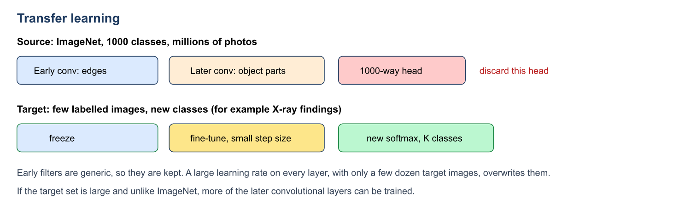

**Worked case.** A chest X-ray set has a few hundred labelled images and three findings. Start from a network trained on ImageNet. Delete the 1000-way softmax. Put on a 3-way softmax. Freeze the early convolutional layers. Train the new head, and optionally the last convolutional block, with a learning rate such as $`10^{-4}`$ or smaller. If instead every layer is trained with a learning rate of $`0.1`$, the edge filters are overwritten and the small set is memorised.

**Long answer.** The four steps, the freeze rule, the X-ray case, and one sentence on why early layers transfer (edges and textures are not specific to the 1000 ImageNet classes).

---

# Unit B — Sequence modelling

## B1. Temporal data, and why the CNN is not enough

A sequence is ordered. “Dog bites man” and “man bites dog” use the same words and mean different things. Speech, an ECG, a video, and a stock series are the same kind of object: each step depends on what came before, and the length is not fixed.

A convolution looks inside a window, then forgets the window. It has no state. An RNN adds a **hidden state** $`h`$, updated at every step, with the **same weights** at every step. Sharing across time is the cousin of a CNN sharing a filter across space. Say that. It is in the lecture notes on purpose.

## B2. The RNN cell


```math
h_t = \tanh(W_{xh} x_t + W_{hh} h_{t-1} + b_h), \qquad y_t = W_{hy} h_t + b_y.
```


$`x_t`$ is the input now. $`h_{t-1}`$ is the memory. $`W_{xh}`$ reads the input. $`W_{hh}`$ carries memory. $`W_{hy}`$ turns memory into a prediction. Unrolling draws the cell many times. Those boxes are **one** cell. They do not have private weights.

**Worked scalar example from class.** $`x = (1,\ 0.5,\ -1)`$, $`W_{xh} = 0.5`$, $`W_{hh} = 0.8`$, $`b_h = 0.1`$, $`W_{hy} = 1`$, $`b_y = 0`$, $`h_0 = 0`$.

- $`t = 1`$: $`\tanh(0.5\cdot 1 + 0.8\cdot 0 + 0.1) = \tanh(0.6) = 0.537`$. So $`y_1 = 0.537`$. The memory term is zero because $`h_0 = 0`$.
- $`t = 2`$: $`\tanh(0.5\cdot 0.5 + 0.8\cdot 0.537 + 0.1) = \tanh(0.780) = 0.652`$.
- $`t = 3`$: $`\tanh(0.5\cdot(-1) + 0.8\cdot 0.652 + 0.1) = \tanh(0.122) = 0.121`$.

The same five numbers were used at every step. $`y_3`$ still depends on $`x_1`$, but only through the chain of hidden states.

### Shapes of problem

| Shape | Example | What you write |
|---|---|---|
| One-to-one | ordinary feedforward net | Not really recurrent. |
| One-to-many | image captioning | One image, a sequence of words. |
| Many-to-one | sentiment, one label for an ECG | Read the whole sequence, emit one vector. |
| Many-to-many, aligned | part-of-speech tags | One output per input step. |
| Many-to-many, unequal | translation, speech to text | Encoder–decoder. Lengths differ. |

## B3. BPTT — how the shared weights are trained

The loss is the **sum** of the per-step losses, $`L = \sum_t L_t`$. For softmax and cross-entropy, $`L_t = -\sum y_t \log \hat{y}_t`$, and the output error is $`\hat{y}_t - y_t`$. The tanh slope is $`1 - h_t^2`$.

Training unrolls the net, runs the forward pass, then walks **backward from the last step**. A shared weight appears once per step, so


```math
\frac{\partial L}{\partial W} = \sum_t \frac{\partial L}{\partial W^{(t)}}.
```


That sum is the only new rule. BPTT is ordinary backpropagation on the unrolled graph.

**Which matrix needs the through-time path?** $`W_{hy}`$ is used after $`h_t`$ already exists, so its gradient is a sum of local terms. $`W_{xh}`$ and $`W_{hh}`$ sit inside $`h_{t-1} \to h_t`$. Changing them changes every later state, so the error must be carried back through $`W_{hh}^\top`$.

The efficient backward step from the lecture:

1. Output error $`\partial L / \partial o_t = \hat{y}_t - y_t`$.
2. Error at the hidden state $`=`$ this step’s output error $`+`$ the error flowing back from step $`t+1`$.
3. Multiply by $`1 - h_t^2`$ to pass through tanh. Call the result $`\delta_t`$.
4. $`\partial L / \partial W_{xh} = \sum_t \delta_t x_t^\top`$.

With a one-hot input, step $`t`$ writes into **one column**, the column of the character that was read. In the “hope” example the inputs are h, o, p and the targets are o, p, e. The column for **e** stays zero because e is never an input. The column for **h** changes once later losses are allowed to flow back. If you drop the $`W_{hh}^\top \delta_{t+1}`$ term, the early columns are simply wrong. One update in class moved the loss from $`3.808`$ to $`3.777`$.

**Vanishing gradient.** Each step multiplies the error by a weight times a tanh slope. Ten factors of $`0.5`$ leave about $`0.001`$. Early words stop teaching the weights. “Ravi, who grew up in Coimbatore and studied at PSG Tech …, says ___” should be completed by “he”. A plain RNN has usually forgotten “Ravi”. Exploding is the opposite illness: the factors are larger than 1 and the update blows up. LSTM’s cell state is aimed at the vanishing case.

**Long answer.** Draw the unroll. Write $`h_t`$. Say the gradient of a shared weight is a sum over time. Say which of $`W_{xh}`$, $`W_{hh}`$, $`W_{hy}`$ needs the through-time term. Give the Ravi sentence as the symptom, and the product of slopes as the cause. The sum over copies is the definition of BPTT.

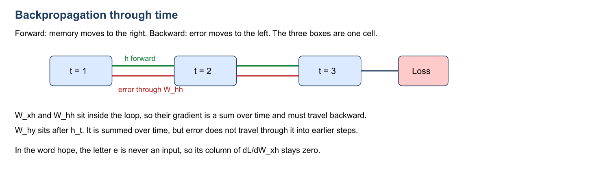

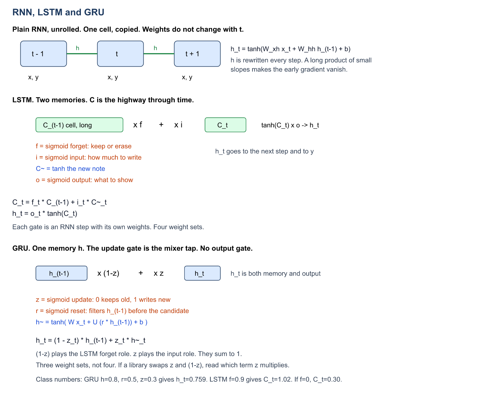

## B4. Bidirectional RNN

One chain reads left to right. A second chain reads right to left. Their hidden states are combined, by concatenation in a BiLSTM. The word can use the future.

Use it when the **whole sequence is already in hand**: named-entity recognition, or cutting a recorded ECG into segments. Do not use it for live next-tick prediction. The future ticks do not exist yet, so the backward chain has nothing to read.

A stacked (deep) RNN puts another RNN on top of the first. The lower layer must return the **whole sequence** (`return_sequences=True` in the Keras snippet), because the upper layer needs a sequence, not one vector. If the lower layer returns only its last state, the upper layer has a single vector and cannot be recurrent over the words.

**Worked sentence.** “Paris is the capital of France.” A forward state at “capital” has seen “Paris is the”. A backward state at “capital” has seen “of France”. Joining them lets the label of “capital” use both the city and the country. A live keyboard that must guess the next letter cannot run the backward chain, because the future letters have not been typed.

## B5. Encoder–decoder

Translation and speech-to-text have unequal lengths. “I love AI” and “Ich liebe künstliche Intelligenz” are not the same number of tokens, so an aligned many-to-many model, which emits one label per input step, does not fit. The encoder reads the whole input and compresses it. In the plain RNN version the decoder is started from **one vector**, the encoder’s last hidden state, and then writes one output token at a time until an end token.

That single vector is the bottleneck. A long sentence does not fit cleanly inside one $`h`$, and the first input word has been through every later step before it reaches the decoder. Attention, and then the Transformer, keep **one vector per input token** and let the decoder look them up. The limitation of the basic encoder–decoder is this bottleneck.

Training uses teacher forcing: the decoder is fed the true previous target word, shifted one step to the right, not its own earlier guess. At test time there is no true previous word, so the decoder consumes its own output. Greedy decoding keeps the single most probable next word. Beam search keeps several partial translations (the lecture illustrates a beam of 4) and continues the best ones.

The five shapes, so they are not confused with the encoder–decoder:

- one-to-one is an ordinary feedforward net;
- one-to-many is captioning: one image, many words;
- many-to-one is sentiment: many words, one label;
- aligned many-to-many is part-of-speech tagging: one tag per word;
- unequal many-to-many is the encoder–decoder: translation, speech to text.

## B6. Recursive nets

A **recurrent** net walks a chain: $`h_t`$ comes from $`h_{t-1}`$.

A **recursive** net walks a tree. The same composition function builds a parent from its children. For the phrase “not very good”, the net first composes “very good” and then applies “not”. The tree is usually a syntactic parse. Phrase-level sentiment is the standard example. The same weights are used at every parent, which is weight sharing on the tree, the way an RNN shares weights along time.

Bidirectional and stacked RNNs are still chains. They are not the definition of a recursive net. A recursive net needs a tree. If the question gives only a sequence and no parse, the model to name is recurrent, bidirectional, or an encoder–decoder, not recursive.

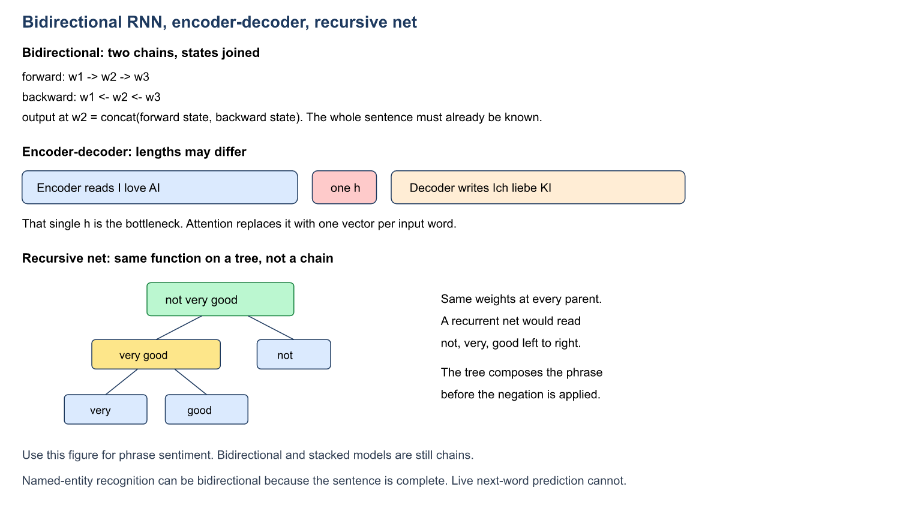

## B7. LSTM

Hochreiter and Schmidhuber, 1997. A plain RNN rewrites its only memory every step, like wiping a whiteboard. An LSTM keeps a **cell state** $`C`$, a notebook you edit line by line, and a **hidden state** $`h`$, the line you show to the next step and to the output.

Four small RNN steps run in parallel, each with its own weights. Gates use a sigmoid, a valve in $`(0, 1)`$. The candidate uses tanh, so the new note lies in $`(-1, 1)`$.

```math
\begin{align*}
f_t &= \sigma(W_f x_t + U_f h_{t-1} + b_f) \\
i_t &= \sigma(W_i x_t + U_i h_{t-1} + b_i) \\
\tilde{C}_t &= \tanh(W_c x_t + U_c h_{t-1} + b_c) \\
C_t &= f_t \odot C_{t-1} + i_t \odot \tilde{C}_t \\
o_t &= \sigma(W_o x_t + U_o h_{t-1} + b_o) \\
h_t &= o_t \odot \tanh(C_t)
\end{align*}
```

| Part | Question it answers | Equation |
|---|---|---|
| Forget f_t | What old memory do I erase? | sigmoid(W_f x_t + U_f h_(t-1) + b_f) |
| Input i_t | How much of the new note do I write? | sigmoid(W_i x_t + U_i h_(t-1) + b_i) |
| Candidate C~_t | What is the new note? | tanh(W_c x_t + U_c h_(t-1) + b_c) |
| Cell | Keep some old, add some new | C_t = f_t * C_(t-1) + i_t * C~_t |
| Output o_t | What do I show now? | sigmoid(W_o x_t + U_o h_(t-1) + b_o) |
| Hidden | The value passed on | h_t = o_t * tanh(C_t) |

$`\odot`$ is element-wise. Each memory slot has its own gate value.

**Numbers from class.** $`C_{t-1} = 0.8`$, $`f = 0.9`$, $`i = 0.5`$, $`\tilde{C} = 0.6`$, $`o = 0.7`$.


```math
C_t = 0.9 \times 0.8 + 0.5 \times 0.6 = 0.72 + 0.30 = 1.02,
```


```math
h_t = 0.7 \times \tanh(1.02) = 0.7 \times 0.770 = 0.539.
```


If $`f_t = 0`$, the old cell is gone and $`C_t = 0.30`$ only.

**Why the gradient survives.** Going backward along $`C`$, the multiplier is the forget gate, not a tanh slope. The net learns to hold $`f`$ near 1 when the fact is still needed. $`0.9^{10} \approx 0.35`$, while $`0.5^{10} \approx 0.001`$. The cell path is multiply-and-add, with no squash on the addition itself. Same idea as ResNet’s skip, applied through time instead of depth.

The output gate is why memory and “what we say now” can differ. “Ravi” can sit in $`C`$ through the long clause, and $`o`$ opens only at “says ___”, exposing “singular, male” so the model predicts “he”.

**6 marks.** Two memories, three gates plus the candidate, both equations, and the sentence about $`f \approx 1`$.

## B8. GRU, the lighter LSTM

Cho et al., 2014. Three simplifications:

- cell and hidden state are merged into one $`h`$;
- forget and input are tied into one **update** gate $`z`$, so the keep fraction and the write fraction sum to 1;
- there is no output gate, so the whole $`h`$ is exposed;
- a **reset** gate $`r`$ decides how much of the past is used while writing the candidate.

Lecture equations, in the order you should memorise:


```math
\begin{align*}
r_t &= \sigma(W_r x_t + U_r h_{t-1} + b_r), \\
z_t &= \sigma(W_z x_t + U_z h_{t-1} + b_z), \\
\tilde{h}_t &= \tanh\big(W_h x_t + U_h (r_t \odot h_{t-1}) + b_h\big), \\
h_t &= (1 - z_t) \odot h_{t-1} + z_t \odot \tilde{h}_t.
\end{align*}
```


Read $`z`$ as the mixer tap. $`z = 0.2`$ keeps 80% and writes 20%. $`z = 0`$ copies $`h_{t-1}`$ unchanged, and the backward factor $`(1-z)`$ is 1, so the gradient passes. $`z = 1`$ throws the old state away. $`r = 0`$ builds the candidate from the current input alone.

**Numbers from class.** $`h_{t-1} = 0.8`$, $`r = 0.5`$, $`z = 0.3`$, and $`W_h x_t = 0.4`$, $`U_h = 1`$, $`b_h = 0`$.


```math
\tilde{h} = \tanh(0.4 + 1\cdot(0.5 \cdot 0.8)) = \tanh(0.8) = 0.664,
```


```math
h_t = 0.7 \times 0.8 + 0.3 \times 0.664 = 0.560 + 0.199 = 0.759.
```


Some code, including a common PyTorch form, writes $`h_t = z_t \odot h_{t-1} + (1-z_t)\odot \tilde{h}_t`$. The mixer is the same. The **meaning of the letter $`z`$** has flipped. In an exam, use the lecture form unless the question prints the other one.

| | RNN | LSTM | GRU |
|---|---|---|---|
| Memory | h only, fully rewritten | C long, h short | h only |
| Gates | none | forget, input, output | reset, update |
| Weight sets | 1 | 4 | 3 |
| Long range | weak, about 10 steps | strong | strong |
| When to pick it | short sequences | very long sequences, large data, need a separate output gate | less data, less compute, edge devices. Try it first. |

`GRU(128)` has about three-quarters the parameters of `LSTM(128)`. Chung et al. (2014) found them comparable on music and speech. Neither wins every task. A bidirectional GRU is allowed: wrap the cell, do not invent a new one.

**The Ravi story in GRU language.** At a new sentence, $`r \approx 0`$, so the candidate ignores stale context. While the clause “who grew up in Coimbatore…” is read, $`z \approx 0`$, so “Ravi, singular, male” is copied forward. At the word “Ravi” itself, $`z \approx 1`$ and the new subject is written.

## B9. Attention

Self-attention gives every word, in one step, a weighted view of every other word. In “the animal didn’t cross the street because it was too tired”, “it” needs “animal”. Change “tired” to “wide” and “it” needs “street”. A chain of RNN updates is a bad place to keep that fact. Attention computes it directly.

Each word is projected three ways:

- **Query** — what am I looking for?
- **Key** — what can I be matched on?
- **Value** — what do I hand over if I am chosen?


```math
\mathrm{Attention}(Q, K, V) = \mathrm{softmax}\!\left(\frac{QK^\top}{\sqrt{d_k}}\right) V.
```


The softmax is along each row, so the weights that mix the values **sum to 1**. Dividing by $`\sqrt{d_k}`$ matters: if $`d_k`$ is large, the dots are large, softmax becomes nearly one-hot, and the gradient dies.

**Toy numbers from the lecture, one head, $`d_k = 2`$.** After the projections, the scores $`QK^\top`$ for “I / love / AI” are


```math
\begin{bmatrix} 0 & 4 & 4 \\ 4 & 0 & 4 \\ 4 & 4 & 8 \end{bmatrix}.
```


Divide by $`\sqrt{2} \approx 1.41`$, then softmax. The first row becomes about $`(0.029,\ 0.486,\ 0.486)`$. So “I” is rebuilt mostly from “love” and “AI”. You do not need to recompute the exponentials in the exam unless the question gives you the scores. You do need to say: scale, then softmax, then a weighted sum of values.

**Multi-head.** The original model runs this 8 times with different $`W_Q, W_K, W_V`$, each of width 64. Concatenate $`8 \times 64 = 512`$, then a matrix $`W_O`$ mixes the heads. Cost is about one big attention. Different heads can specialise (a pronoun and its noun, a verb and its subject). Nobody programs that specialisation. It is learned.

Three places this block appears in the full Transformer:

1. **Encoder self-attention.** Q, K, V all from the source. No mask. Every source word sees every source word.
2. **Masked decoder self-attention.** Q, K, V from the target words so far. Future scores are set to $`-\infty`$ before the softmax, which becomes weight 0. Position $`t`$ cannot see the answer it is supposed to predict.
3. **Cross-attention.** Q from the decoder. K and V from the encoder output $`M`$. This is where the German word looks at the English words.

## B10. The Transformer

Vaswani et al., 2017, “Attention Is All You Need”. Recurrence is removed. Every position in a layer is computed together, so training parallelises. Long-range pairs meet in one step instead of through dozens of hidden-state updates.

**Positional encoding must be added**, element by element, not concatenated. Attention treats its input as a set. Without a position signal, “dog bites man” and “man bites dog” are the same bag of vectors. The original paper uses


```math
PE(pos, 2i) = \sin(pos / 10000^{2i/d}), \qquad PE(pos, 2i+1) = \cos(pos / 10000^{2i/d}).
```


Even dimensions take sine, odd take cosine, of one shared angle. Adding keeps the width equal to $`d_{\text{model}}`$. A shift of position is a linear function of that sine–cosine pair, so relative position can be learned. BERT later **learns** the position vectors instead, and only up to 512.

Each sublayer is wrapped as $`\mathrm{LayerNorm}(x + \mathrm{Sublayer}(x))`$. The residual is the same skip idea as ResNet. The feed-forward block is applied **to each position separately**,


```math
\mathrm{FFN}(x) = \max(0,\ xW_1 + b_1)W_2 + b_2,
```


expanding 512 to 2048 and back, with the same weights at every position. Attention mixes **across** words. The feed-forward block transforms **inside** one word.

**The “I love AI” → “Ich liebe KI” picture.**

- Encoder runs **once**. Tokenise, embed, add positions, then 6 layers. Output $`M`$: one vector per English word. The encoder never sees German.
- Decoder writes one German word at a time. Its input is the target shifted right, starting from `<s>`. It may look at its own past (masked) and at $`M`$ (cross-attention). It may not look at future German words.
- Training uses **teacher forcing**: the gold target is fed, shifted by one, and every next-token loss is computed in parallel. The loss is cross-entropy. The original training recipe also uses Adam with a warm-up, dropout 0.1, and label smoothing 0.1.
- At inference, append the chosen word and run the decoder again until `</s>`. **Greedy** decoding keeps the single best next word. **Beam search** keeps several partial sentences (the lecture illustrates a beam of 4). $`M`$ is not recomputed.

Original base model: 6 encoder layers and 6 decoder layers, $`d_{\text{model}} = 512`$, 8 heads, $`d_k = 64`$, feed-forward width 2048, about 65 million parameters.

Three families. A theory answer should name which one the question is about, because they do not share a mask or a job:

| Family | Who | What it can see | Jobs |
|---|---|---|---|
| Encoder–decoder | original Transformer, T5, BART | source fully; target only on the left | translation, summarisation |
| Encoder-only | BERT, RoBERTa | the whole input, both directions | classification, entities, extractive QA |
| Decoder-only | GPT, LLaMA | only tokens on the left | generation, chat, code |

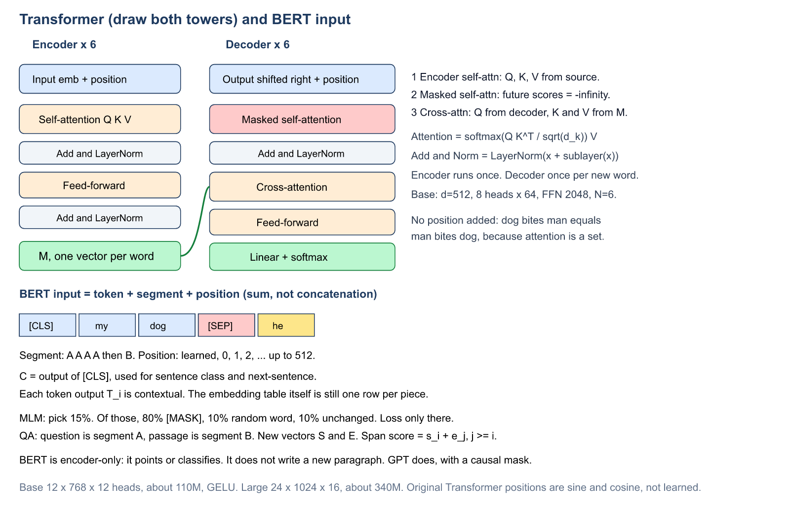

**10 marks.** Draw both towers. Mark the three attentions and where Q, K, V come from. Write the scaled-dot-product formula and say why the square root is there. Say why positions are added. Say encoder once, decoder per output word.

## B11. Case study — sentiment with an RNN, LSTM, or GRU

A review is many words and one label. That is **many-to-one**.

```text
Embedding(vocabulary, 64)
LSTM(128) or GRU(128) or SimpleRNN(128)   # last state only
Dense(1, sigmoid)
loss = binary cross-entropy
```

The embedding turns each word id into a learned vector. The recurrent layer reads the review. Its **final** state summarises the sentence. A sigmoid makes a probability of “positive”. Binary cross-entropy is the matching loss. Swapping `SimpleRNN` for `LSTM` or `GRU` is one line. Use LSTM or GRU when the review is long enough for a plain RNN to forget the opening clause.

If the task were part-of-speech tagging, the head would emit a softmax over tags **at every step**, and the recurrent layer would return the full sequence. One sigmoid for the whole sentence would be the wrong shape.

**What to write for the case study.**

1. The shape is many-to-one: the review is a sequence, the label is one bit or one class.
2. Draw embedding, then LSTM or GRU, then a dense sigmoid. Say the recurrent layer returns only the last state, because there is one decision for the whole review.
3. The embedding is a learned table. A word id is a row of that table, not a one-hot vector that stays one-hot.
4. The loss is binary cross-entropy when the label is positive or negative. A three-class review (negative, neutral, positive) would use a softmax and categorical cross-entropy instead.
5. A plain RNN is enough for a short review. A long review that opens with a complaint and ends with a compliment needs the cell state of an LSTM, or the update gate of a GRU, so the opening clause is still available at the last step.
6. Contrast in three lines with part-of-speech tagging (one tag per word, full sequence returned) and with translation (encoder–decoder, two different lengths). Sentiment is neither of those.

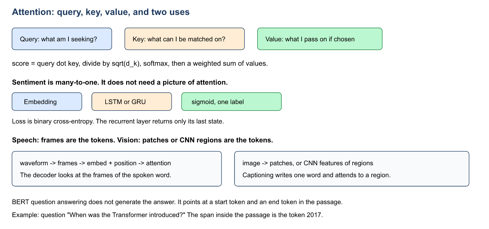

## B12. BERT

Devlin et al., 2019. BERT is a stack of Transformer **encoder** layers. There is no decoder, no causal mask, and no cross-attention. Every token can see every other token in every layer.

| | BERT-base | BERT-large | Original Transformer base |
|---|---|---|---|
| Layers | 12 | 24 | 6 + 6 |
| Hidden size | 768 | 1024 | 512 |
| Heads | 12 | 16 | 8 |
| Feed-forward | 3072 (GELU) | 4096 | 2048 (ReLU) |
| Parameters | ~110 million | ~340 million | ~65 million |
| Positions | learned, max 512 | learned, max 512 | fixed sine / cosine |

**Why “deeply bidirectional” is a comparison, not a slogan.**

- word2vec or GloVe: one frozen vector per word type. The fruit “apple” and the company “Apple” share it.
- GPT: a causal mask, so a token sees only its left.
- ELMo: a left-to-right LSTM and a right-to-left LSTM, joined by concatenation at the end. The two directions never meet inside a layer.
- BERT: no mask. Both directions meet in every layer.

The embedding **table** is still one row per WordPiece. Context appears only after attention. That is why the same piece gets different output vectors in “I ate an apple” and “Apple released a phone”.

**Input of one token** $`=`$ token embedding $`+`$ segment embedding $`+`$ position embedding. They are summed. `[CLS]` starts every sequence; its output $`C`$ is the sentence vector. `[SEP]` ends a segment. WordPiece (about 30,000 pieces) splits rare words: “playing” can become “play” + “##ing”.

**Pretraining, once, on unlabeled books and Wikipedia.**

1. **Masked language model.** Choose 15% of positions. Of those, 80% become `[MASK]`, 10% become a random word, 10% stay unchanged. Predict the original piece, but put the loss **only** on the chosen positions. The other words stay visible, so looking both ways does not make the task trivial. The 10% unchanged case exists because `[MASK]` is common in pretraining and absent at fine-tuning. The model must still understand a token it actually sees.
2. **Next-sentence prediction.** From $`C`$, decide IsNext or NotNext. Half the time sentence B really follows A. The two losses are added. Question answering needs the relation between two texts, which masked words alone do not teach. RoBERTa later dropped this task and still improved, by training longer on more data. Know that, in case the question asks for a limitation of the original recipe.

**Fine-tuning is transfer learning.** Add one small head. Update the stacked weights on a labeled set for a few epochs, with a small learning rate ($`5\times 10^{-5}`$, $`3\times 10^{-5}`$, or $`2\times 10^{-5}`$ in the paper). Sentence tasks read $`C`$. Token tasks read every $`T_i`$.

**Extractive question answering (SQuAD).** The answer is a span copied from the passage, not a sentence the model writes.

- Pack `[CLS] question [SEP] passage [SEP]`. Question is segment A. Passage is segment B.
- Fine-tuning learns two new vectors, $`S`$ and $`E`$. Start score of token $`i`$ is $`S \cdot T_i`$. End score is $`E \cdot T_i`$.
- A legal span has end $`\ge`$ start, lies inside the passage, and is not huge (about 30 tokens in the usual implementation). Its score is start score plus end score.
- The lecture’s running example: “When was the Transformer introduced?” answered by pointing at “2017” in the passage. Both start and end land on that token.
- SQuAD 1.1: every question has an answer in the passage. SQuAD 2.0: some do not. “No answer” is the span at `[CLS]`. Return a real span only if it beats that null score by a margin.
- A deployed system still needs a **retriever** (BM25 or a dense search). BERT reads at most 512 tokens, so something else must pick a few passages out of a large collection.

Limits worth a 2-mark tail: 512 tokens, attention cost grows with the square of the length, `[MASK]` never appears at fine-tuning, and an encoder does not generate. DistilBERT is the “smaller and faster, keeps most of the accuracy” successor (about 40% smaller, 60% faster, about 97% of the language understanding). ELECTRA learns from every token by detecting replacements, instead of only the masked 15%. ALBERT shares weights across layers and replaces next-sentence prediction with sentence-order prediction. Longformer and BigBird use sparse attention to pass 512 tokens.

## B13. Attention for speech and for computer vision

The Transformer does not know that its tokens came from words. Cut the signal into pieces, embed each piece, add positions, and run the same attention.

- **Speech.** Audio frames or windows become the tokens (the lecture’s example is the Whisper style of model). The decoder, or a later encoder layer, can put its weight on the frames that actually contain the word being written, instead of squeezing the whole utterance into one RNN state. Keyword spotting on a phone is also a GRU application from the GRU deck: fewer parameters, on-device.
- **Vision.** ViT cuts an image into patches and treats each patch as a token. Self-attention then mixes patches. That is different from a CNN, which shares a small filter on the grid. Captioning stays **one-to-many**: a CNN or a patch encoder reads the image, and a decoder writes the words, attending to the relevant region at each word. Frame features from a CNN, followed by an LSTM, are the lecture’s recipe for video and activity recognition.

**Long answer.** One paragraph on speech frames as tokens, one on image patches or captioning, and one sentence that the attention formula did not change. Use the lower half of the figure in B11. The upper half of that figure is the sentiment head, which is many-to-one and does not itself use query, key, and value.

---

# Unit C — Unsupervised models

An unsupervised model is not handed a class label. It has to find structure in $`x`$. Self-supervised is the special case where the target is built from $`x`$ itself (reconstruct $`x`$, predict a masked word). Semi-supervised, at the end of this unit, is the case with a **few** real labels and a large unlabeled set. The three words are different. A theory answer that swaps them loses the comparison.

## C1. What an autoencoder is

An autoencoder writes $`\hat{x}`$ and is trained so that $`\hat{x}`$ is close to $`x`$. No labels. The useful object is not $`\hat{x}`$. It is the short code $`z`$ in the middle. After training, the decoder is often thrown away and the encoder is kept as a feature extractor.


```math
z = f_\theta(x), \qquad \hat{x} = g_\phi(z), \qquad \min \frac{1}{n}\sum_i L\big(x_i,\ g_\phi(f_\theta(x_i))\big).
```


Mean squared error for real-valued signals. Binary cross-entropy, with a sigmoid output, when inputs lie in $`[0, 1]`$, such as pixel intensities. Tied weights $`W' = W^\top`$ are optional: half the parameters, and a regulariser.

Three properties from the lecture:

- **Data-specific.** A face autoencoder compresses trees badly. That is also why a strange input reconstructs badly, which is the anomaly detector.
- **Lossy.** Detail is dropped in the narrow code. This is not a general-purpose replacement for JPEG.
- **Learned.** JPEG and MP3 use a fixed rule for every image or song. The autoencoder learns a rule for one kind of data.

**Undercomplete:** code dimension $`k < d`$. The bottleneck itself forces the net to keep the informative directions. **Overcomplete:** $`k \ge d`$. Copying $`x`$ is then a perfect solution, so you must add sparsity, noise, or a contraction penalty.

A **linear** autoencoder with squared error spans the same subspace as PCA. Nonlinear layers can follow a curved manifold. Hinton and Salakhutdinov (2006) compressed digits and faces to 30 numbers and beat PCA at the same code size. The layer sizes in class, $`784 \to 1000 \to 500 \to 250 \to 30`$ and back, are that experiment.

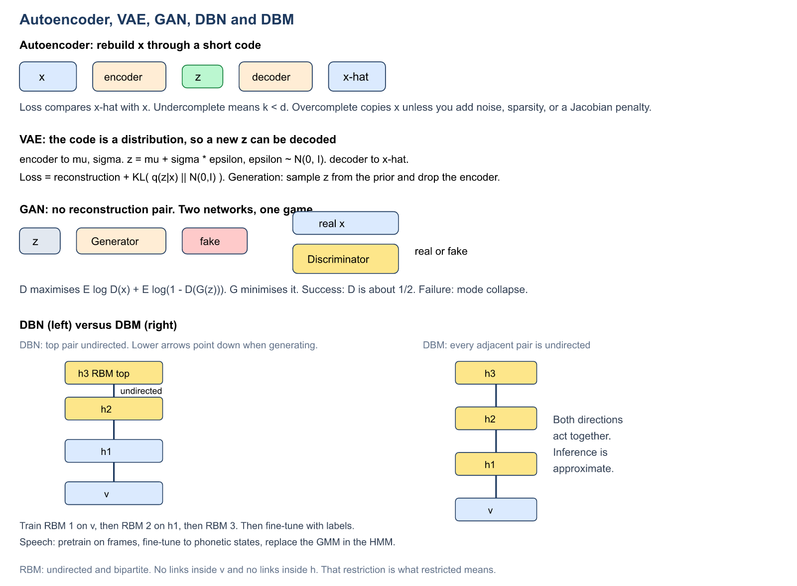

## C2. The types, each with the constraint that stops copying

**Vanilla.** One hidden layer is the code. Linear version $`\approx`$ PCA. A starting point, not a rich model.

**Multilayer / deep.** Several hidden layers on each side of the code. Features get more abstract: edges, then parts, then objects.

**Stacked, trained greedily.** This is the bridge to deep belief networks, so learn the procedure exactly.

1. Train an autoencoder on $`x`$. Keep the encoder. Discard its decoder.
2. Train a second autoencoder on the codes $`h_1`$. Keep that encoder.
3. Stack the encoders. Add a softmax if you need classes.
4. Fine-tune the whole net by backpropagation. Only step 4 needs labels.

It was invented because a deep net from random weights vanished or fell into a poor minimum. Each layer starts from a sensible representation. With ReLU, batch normalisation, and careful initialisation, end-to-end training usually works now, so greedy pretraining is used mainly when **labels are scarce**.

**Denoising.** Corrupt $`x`$ into $`\tilde{x}`$ (Gaussian noise, random masking, or salt-and-pepper). The loss still compares the output with the **clean** $`x`$. Copying the input no longer scores zero, so the net has to learn the structure that removes the noise. Noise is a training-time device. At test time you feed the real noisy recording (an old photo, a noisy MRI, an ECG with muscle noise) and read the reconstruction. The masking idea is an ancestor of BERT’s mask and of masked autoencoders.

A numerical sketch is enough in the booklet. Suppose a pixel is $`0.8`$. Training adds noise and the network sees $`0.8 + 0.3 = 1.1`$, clipped if the input must stay in $`[0, 1]`$. The target of the loss is still $`0.8`$, not $`1.1`$. If the loss were against the noisy input, the network would learn to copy the corruption.

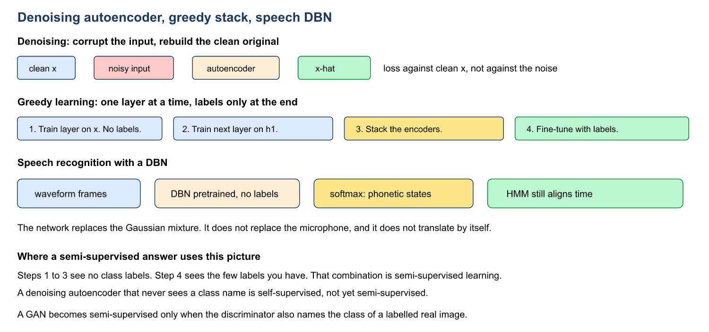

**Convolutional.** A dense autoencoder flattens a $`28 \times 28`$ image and forgets that neighbouring pixels belong together. Convolutions and pooling shrink the map and add channels. A transposed convolution, or plain upsampling, grows it back. Train on defect-free circuit boards and a scratch shows up as a patch of high reconstruction error. U-Net-style segmentation grows from this idea.

**Sparse.** The hidden layer may be **wider** than the input. A penalty keeps most units near zero:


```math
L = \|x - \hat{x}\|^2 + \beta \sum_j \mathrm{KL}(\rho \,\|\, \hat{\rho}_j),
```


with a small target such as $`\rho = 0.05`$. An L1 penalty on the hidden activations is the simpler version. The penalty is on **activations**, not on weights. Raise $`\beta`$ and the code gets sparser while reconstruction gets worse. Each unit behaves like a detector for one pattern.

**Contractive.** Penalise the encoder Jacobian,


```math
L = \|x - \hat{x}\|^2 + \lambda \| \partial h / \partial x \|_F^2.
```


A tiny change in $`x`$ should make a tiny change in the code, except along the directions where real data actually varies. Denoising gets that robustness from noise. The contractive model writes the derivative into the loss. The Jacobian is expensive in a deep encoder, which is one reason denoising autoencoders became the more common of the two.

**Sequence.** An LSTM (or GRU) encoder reads $`x_1, \ldots, x_T`$. The code is the **final hidden state**. An LSTM decoder unrolls that one vector for $`T`$ steps. Use it for ECG beats, machine sensors, or a series whose length varies. Dense and convolutional autoencoders want a fixed grid.

**Which type for which job — memorise this matching.**

| Job | Type |
|---|---|
| Compress, or feed a short vector to a classifier | vanilla or deep |
| Few labels | stacked, then fine-tune |
| Remove noise from images, speech, ECG | denoising |
| Photos, PCB inspection | convolutional |
| A unit that means one pattern | sparse |
| Robustness written into the loss | contractive |
| A whole time series | sequence (LSTM) |
| Draw a new sample | variational |

**Anomaly recipe, any of the reconstructive types.** Train on normal data only. Choose an error threshold on a validation set. Flag a new input whose reconstruction error is higher. This works because the model is data-specific.

## C3. Variational autoencoder

A plain autoencoder stores codes as scattered points. Decode a random point in a gap and you get noise. A VAE (Kingma and Welling, 2013) makes the code a distribution.

1. The encoder outputs $`\mu`$ and $`\sigma`$, and $`q(z \mid x) = \mathcal{N}(\mu, \sigma^2)`$. In code one usually outputs $`\log \sigma^2`$ for stability. The lecture writes $`\sigma`$.
2. **Reparameterise** $`z = \mu + \sigma \odot \varepsilon`$ with $`\varepsilon \sim \mathcal{N}(0, I)`$. The random draw is outside the network, so the gradient still reaches $`\mu`$ and $`\sigma`$. Sampling $`z`$ directly inside the graph would block backpropagation.
3. The loss is the negative ELBO: a reconstruction term, plus $`\mathrm{KL}\big(q(z\mid x)\,\|\,\mathcal{N}(0, I)\big)`$. The KL packs every code cloud onto the standard normal, so the latent space is filled rather than gappy.
4. To generate, throw the encoder away, sample $`z`$ from $`\mathcal{N}(0, I)`$, and decode.

Samples are often blurrier than GAN or diffusion samples, because the reconstruction-plus-KL objective averages. They are much easier to interpolate: a point halfway between two codes decodes to something sensible. The lecture’s uses are new faces or digits, extra samples for a rare medical class, searching a latent space of molecules, and anomaly detection by low likelihood.

## C4. Restricted Boltzmann machines and greedy learning

An **RBM** is an undirected graphical model with two layers, visible $`v`$ and hidden $`h`$. There are no connections inside $`v`$ and none inside $`h`$. “Restricted” means exactly that. Given one layer, the units of the other layer are independent, which makes training possible. It is an energy-based model: low energy for likely $`(v, h)`$ pairs. The usual training approximation is **contrastive divergence**, a short Gibbs chain, not backpropagation through a decoder.

**Greedy layer-wise learning**, shared by stacked autoencoders and deep belief nets:

1. Train the first RBM (or autoencoder) on the raw data.
2. Freeze it. Treat its hidden activations as the data for the next RBM.
3. Repeat.
4. Add a label layer if you need classification, and fine-tune the stack with backpropagation.

Labels are not required for steps 1–3. The reason is the same as in the stacked-autoencoder lecture: a deep net from random weights was hard to train. Greedy initialisation puts every layer near a useful representation before the joint fine-tune.

## C5. Deep belief network and deep Boltzmann machine

These two are a comparison question. Draw both. The difference is the direction of the arrows, not the number of layers.

**Deep belief network (DBN).** A stack of RBMs trained greedily, then reinterpreted as a generative model:

- the **top two layers** remain an undirected RBM;
- the **lower layers** become a directed belief network, with arrows pointing down toward the data;
- to draw a sample, sample the top RBM, then sample downward;
- for classification, put a softmax on top and fine-tune with labels.

**Deep Boltzmann machine (DBM).** Undirected **all the way up**. Every pair of adjacent layers interacts in both directions at once. Bottom-up evidence and top-down context are used together during inference. That inference is approximate (mean-field). A DBM is harder to train than a DBN. It is not “a DBN with another name”.

| | RBM | DBN | DBM |
|---|---|---|---|
| Depth | two layers | many | many |
| Directions | undirected, bipartite | undirected only at the top; directed below | undirected everywhere |
| How it is trained | contrastive divergence | greedy RBMs, then fine-tune | greedy initialisation, then a joint undirected training |
| Inference | easy, because of the restriction | ancestral sample from the top | approximate, both directions at once |

## C6. Speech recognition with a DBN

Classical recognition was an HMM whose emission probabilities came from a Gaussian mixture. The mixture is a weak model of a speech frame.

The DBN pipeline this portion means:

1. Turn the waveform into frames (filterbank energies or similar acoustic vectors).
2. Pretrain a DBN on those frames **with no phonetic labels**, greedy layer by layer. The stack learns a hierarchy of acoustic features.
3. Add a softmax and fine-tune so that each frame is scored as a phonetic HMM state (a senone).
4. The HMM is still there for time alignment. The DBN, used as a deep neural net after fine-tuning, **replaces the Gaussian mixture** as the acoustic model.

The network is the acoustic model. It is not the microphone, and it is not a Transformer translating the sentence by cross-attention. Those belong to other questions. The figure in C2 is the one to redraw: frames, unlabeled pretraining, a softmax over phonetic states, and an HMM that still aligns time.

**Long answer.** Name the old system (HMM plus a Gaussian mixture), say what is weak about a mixture of Gaussians on one frame, then the four steps, then the sentence “the deep net replaces the mixture; the HMM stays”. Close with greedy learning: the lower layers are trained with no phonetic labels, which is why this pipeline can use a large unlabeled speech collection.

## C7. Generative adversarial networks

Goodfellow et al., 2014. Two networks play a game. There is no paired reconstruction $`\|x - \hat{x}\|^2`$.

- The **generator** $`G`$ maps noise $`z`$, usually from a simple Gaussian, to a fake sample $`G(z)`$.
- The **discriminator** $`D`$ sees real $`x`$ and fake $`G(z)`$ and says which is which.

The value function


```math
V(D, G) = \mathbb{E}_{x}[\log D(x)] + \mathbb{E}_{z}[\log(1 - D(G(z)))]
```


is **maximised by $`D`$** and **minimised by $`G`$**. $`D`$ wants to be right. $`G`$ wants $`D(G(z))`$ to look real. At a successful equilibrium, $`D`$ outputs about $`1/2`$ on both sources, because $`G`$ has matched the data distribution and $`D`$ cannot tell them apart.

**Mode collapse** is the usual failure. $`G`$ emits only a few kinds of sample. $`D`$ is still fooled on those few, so the generator never covers the rest of the data.

| | Autoencoder | VAE | GAN |
|---|---|---|---|
| Training signal | rebuild this x | rebuild x, plus KL to a prior | fool D |
| Latent geometry | scattered points, gaps | packed around N(0, I) | no requirement to encode a given x |
| New samples | decoding a random z is usually noise | sample the prior and decode; often blurry | often sharp; training is less stable |
| Labels | none | none | none, until you add a class head |

## C8. Semi-supervised learning

- **Supervised:** every training input has a true label.
- **Unsupervised:** no true labels. Clustering, an RBM, a plain GAN.
- **Self-supervised:** the target is manufactured from the input. Autoencoder reconstruction. BERT’s masked words.
- **Semi-supervised:** a small labeled set plus a large unlabeled set.

The pipeline this unit actually gives you is greedy pretraining plus a small fine-tune. A stacked autoencoder or a DBN is trained on all the unlabeled recordings. A softmax is then trained, and the stack is fine-tuned, on the few labeled ones. Steps 1–3 of the stack use no labels. Step 4 does. That combination **is** semi-supervised learning. A denoising autoencoder that never sees a class label is not semi-supervised yet.

A GAN becomes semi-supervised when the discriminator grows a class head: on a labeled real image it must name the class, and on unlabeled real images and on fakes it still learns “real versus fake”. Until that head exists, a GAN does not know your class names.

**6-mark comparison.** Define the four words above in four sentences, then give the stacked DBN or stacked autoencoder as the worked pipeline, naming which steps see labels.

---

# Written-paper skeletons

Use these when the question is worth 10 marks. Each one is about a page of handwriting if you also draw the figure.

**1. CNN architecture, convolution, and pooling.**
Define a CNN in two sentences (shared filter, grid). Draw image → conv → ReLU → pool → conv → pool → dense → softmax. Compute the $`3 \times 3`$ by $`2 \times 2`$ convolution from section A2, or the max-pool from A3. State the size formula and do $`n=5, f=3, s=1, p=0`$. Name stride, padding, and RGB summation as variants. One line on dropout.

**2. LeNet, AlexNet, VGG, Inception, ResNet.**
One sentence each from the table in A5. Then the VGG arithmetic $`18`$ versus $`25`$, and $`y = F(x) + x`$ with identity versus projection. Mention LRN only under AlexNet, batch norm under Inception and ResNet.

**3. Transfer learning and a recognition task.**
Four steps from A7. Freeze rule. Then say the head is a softmax, and name two applications from A6 (OCR and medical images are the ones on the slide).

**4. RNN, vanishing gradient, BPTT.**
Temporal example “dog bites man”. Equation for $`h_t`$. Unroll, and the sum-over-copies definition. Which weights need through-time backpropagation. The product-of-slopes argument and the Ravi sentence. The scalar three-step example if you have time.

**5. LSTM, with a numerical step.**
Whiteboard versus notebook. Four equations. The numbers that give $`C_t = 1.02`$. What $`f = 0`$ does. Link the cell path to ResNet’s skip. Mention BiLSTM in two sentences if the question says “variants”.

**6. GRU versus LSTM.**
The four lecture equations. The mixer sentence. The numbers that give $`h_t = 0.759`$. The comparison table. The PyTorch warning only if you have already written the lecture equation, so you do not confuse yourself.

**7. Encoder–decoder, attention, Transformer.**
Bottleneck of one vector. Then the scaled-dot-product formula. Draw both towers and mark the three attentions. Positions added, not concatenated. Encoder once, decoder per word. Teacher forcing versus greedy decoding.

**8. BERT.**
Encoder-only, both directions, compared with GPT and ELMo. Input sum of three embeddings. Masked LM percentages. Next-sentence from `[CLS]`. Fine-tuning as transfer. QA as a start index and an end index, with the “2017” example. One limitation (512 tokens, or not a generator).

**9. Sentiment case study.**
Many-to-one. Embedding, LSTM or GRU, sigmoid, binary cross-entropy. Contrast with POS tagging in three lines.

**10. Autoencoders.**
Hourglass. Undercomplete versus overcomplete. Linear case and PCA. Then four types only, chosen to match the question: denoising (loss against clean $`x`$), sparse (penalty on activations), convolutional (neighbourhood kept), VAE (reparameterisation and KL). Anomaly recipe at the end.

**11. DBN, DBM, greedy learning, speech.**
Define an RBM in two sentences. Number the four greedy steps. Draw DBN and DBM and say which links are undirected. Speech: unlabeled frames, fine-tune to phonetic states, replace the GMM, keep the HMM.

**12. GAN, and semi-supervised learning.**
Draw $`z \to G \to`$ fake, and real $`x`$, both into $`D`$. Write $`V(D,G)`$ and say who maximises it. Equilibrium and mode collapse. Then the four-way distinction supervised / unsupervised / self-supervised / semi-supervised, with the stacked DBN as the semi-supervised pipeline.

---

# One-page oral revision

Say these aloud the evening before the paper. Each sentence is the opening line of a theory answer.

- A CNN shares a filter across **space**. An RNN shares a matrix across **time**.
- Output size is $`(n + 2P - f)/S + 1`$. One RGB filter makes one feature map.
- LeNet: tanh, average pool, 60 thousand, digits. AlexNet: ReLU, max pool, dropout, LRN, 60 million, 1000 classes. VGG: stacks of $`3 \times 3`$. Inception: several sizes at once. ResNet: $`y = F(x) + x`$.
- Transfer learning freezes early filters when the new dataset is small.
- BPTT sums the copies of a shared weight. $`W_{hh}`$ carries error backward. $`W_{hy}`$ does not.
- LSTM: $`C_t = f C_{t-1} + i \tilde{C}`$, and $`h = o \tanh(C)`$. Forget near 1 remembers.
- GRU lecture form: $`h = (1-z)\,h_{\text{old}} + z\,\tilde{h}`$. $`z = 0`$ copies memory. $`r = 0`$ ignores the past inside the candidate.
- A bidirectional net needs the future to be already recorded. A recursive net composes a tree.
- The plain encoder–decoder owns one vector. The Transformer owns one vector per input token, in $`M`$.
- Attention weights are a softmax of scaled scores. The decoder mask is $`-\infty`$ on the future.
- BERT masks 15%, then 80 / 10 / 10. `[CLS]` does sentences. QA points at a start and an end. BERT does not write the answer.
- An autoencoder rebuilds $`x`$. A narrow code, or noise, or a penalty, or it will copy. A VAE can sample $`z`$ from a prior. A GAN does not rebuild a paired $`x`$.
- A DBN is undirected only at the top. A DBM is undirected all the way up.
- Semi-supervised means a few labels plus many unlabeled inputs. Pretrain, then fine-tune.
